<!-- ░░ Header ░░ -->
<p align="center">
  
</p>

<p align="center">
  <a href="https://github.com/SivarishiB">
    
  </a>
</p>

<p align="center">
  <a href="https://www.linkedin.com/in/sivarishi-b-0200b6296"></a>
  <a href="mailto:sivarishi.b18@gmail.com"></a>
  <a href="https://instagram.com/siva._.rishi"></a>
  
  
  
</p>

<!-- ░░ The fun part: ASCII portrait + neofetch ░░ -->
<p align="center">
  
</p>

---

## ⚡ `whoami`

```python
class Rishi:
    def __init__(self):
        self.role       = "Python / Django Full-Stack Developer"
        self.education  = "B.Tech CSE · SRM Institute of Science and Technology · 2025 (CGPA 8.37)"
        self.experience = ["Software Development Intern @ Infosys"]
        self.certified  = ["Oracle Certified MySQL 8.0 Developer", "Diploma in IT Programming · Livewire"]
        self.location   = "Bengaluru, India"
        self.ask_me     = ["App development", "Database management"]
        self.fun_fact   = "I play football ⚽"

    def currently(self):
        return "building things with Django & SQL, and looking for my next SDE role"
```

## 🧰 Tech stack

<p align="center">
  <a href="https://skillicons.dev">
    
  </a>
</p>

<details>
  <summary><b>🔍 Click to see how I'd rate myself</b></summary>
  <br/>

| Area | Tools | Comfort |
|---|---|---|
| **Backend** | Python, Django, REST APIs, Node.js |  |
| **Databases** | MySQL 8.0, SQL, Supabase |  |
| **Frontend** | JavaScript, TypeScript, React |  |
| **Data / ML** | Pandas, NumPy, TensorFlow, OpenCV |  |
| **Workflow** | Git, Linux / UNIX CLI |  |

  <sub>Tweak the numbers in the URLs to match how you actually feel.</sub>
</details>

## 🚀 Featured projects

<table>
<tr>
<td width="50%" valign="top">

### 🛡️ Night Guardian
AI-powered women's safety system that watches camera feeds with deep neural networks and flags threats in real time.


<details>
<summary>How it works</summary>

- Ingests live video frames through OpenCV
- Runs a TensorFlow deep neural network to classify risky situations
- Raises alerts so help can be dispatched fast

</details>

[**→ View repo**](https://github.com/SivarishiB?tab=repositories)

</td>
<td width="50%" valign="top">

### 🛍️ Elegant Shopping
Full e-commerce platform built on Django + MySQL with role-based access, multiple payment methods and a coupon engine.


<details>
<summary>What's inside</summary>

- Role-based access for customers, staff and admins
- Catalog → cart → order → payment flow
- Coupon engine and product reviews

</details>

[**→ View repo**](https://github.com/SivarishiB?tab=repositories)

</td>
</tr>
</table>

## 📊 GitHub stats

<p align="center">
  
  
</p>
<p align="center">
  
</p>

<details>
  <summary><b>📈 Contribution graph</b></summary>
  <br/>
  
</details>

<!-- ░░ Snake eats contributions (generated by .github/workflows/snake.yml) ░░ -->
<p align="center">
  <picture>
    <source media="(prefers-color-scheme: dark)" srcset="https://raw.githubusercontent.com/SivarishiB/SivarishiB/output/snake-dark.svg"/>
    
  </picture>
</p>

<p align="center">
  
</p>
